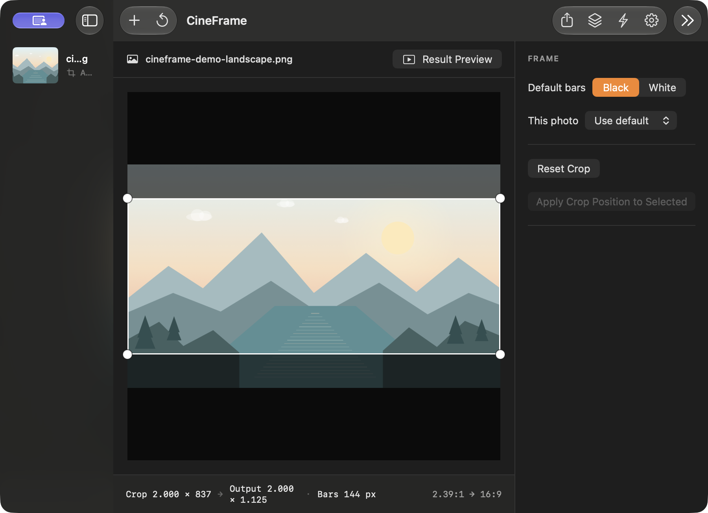

# CineFrame

CineFrame is a native macOS 14+ SwiftUI utility that turns still images into a 2.39:1 crop on a 16:9 frame. It retains full-resolution pixels, centers equal black or white bars, writes a new file, and leaves the source untouched.



## Install

Install with [Homebrew](https://brew.sh/):

```sh
brew install --cask macfreeapps/tap/cineframe
```

CineFrame is not notarized by Apple. On first launch, macOS may ask you to approve it in **System Settings → Privacy & Security → Open Anyway**.

## Build

The project is generated with XcodeGen and has no third-party runtime dependencies.

```sh
xcodegen generate
xcodebuild -project CineFrame.xcodeproj -scheme CineFrame -destination 'platform=macOS' test
```

Open `CineFrame.xcodeproj` in Xcode to run the app. The target enables App Sandbox, hardened runtime, user-selected read/write access, app-scoped folder bookmarks, and Pictures-folder access. Finder’s Open With and Dock file drops are registered for images and the common RAW extensions.

## Use

- Open or drop one or more photos. Directories are scanned one level deep.
- Drag the crop to reposition it; drag a corner to resize at the locked 2.39:1 ratio. Pinch to resize, use arrow keys to nudge one preview pixel, and Shift+arrow to nudge ten.
- Switch to Result Preview to inspect the final 16:9 frame. Set a default bar color, with a per-photo override in the inspector.
- Export the selected photos with ⌘E, or the full queue with ⇧⌘E. Export errors stay on the affected queue row.
- Quick Mode processes drops immediately with a center crop and no editor. Toggle it in the toolbar or with ⌥⌘Q.

Settings cover center or saliency crop anchoring, output folder, suffix, format, JPEG/HEIC quality, Finder reveal, GPS stripping, the optional Cinematic keyword, file dates, and bounded export concurrency.

## Support

If CineFrame is useful to you, you can [mời mình một ổ bánh mì](https://buy-me-a-banhmi.vercel.app/#donate). Each bánh mì is 25,000 VND, with donations sent through VietQR. The page notes that confirmed donation details appear on its public gratitude board. Thank you for supporting development.

## Image and metadata handling

- ImageIO applies EXIF orientation while producing an export-resolution image and a 2048-pixel preview. Full-resolution images are decoded only in export workers.
- Core Graphics crops on integer pixel edges and copies pixels without resampling. The renderer uses the source color space and component depth where the bitmap format supports them; indexed/unsupported spaces fall back to sRGB. Gray sources remain gray when Core Graphics can create that bitmap context.
- JPEG and HEIC re-encode at the selected quality. PNG stays lossless, TIFF requests LZW compression, RAW decodes through `CIRAWFilter` and defaults to TIFF, and unsupported read-only inputs default to JPEG (PNG when the decoded image has alpha).
- ImageIO metadata is updated with normalized orientation, new dimensions, CineFrame attribution, XMP history, and `cineframe:*` fields. Image property dictionaries are merged for metadata readers that do not use XMP. The ICC profile travels with the rendered image color space.
- Face/region data, EXIF SubjectArea, and stale thumbnails are removed or regenerated. HDR gain maps, depth, and portrait mattes are dropped because their geometry no longer matches; the SDR frame is retained.
- Output names use `<source>_cinematic.<ext>` and increment on collisions. Source dates are copied when Preserve file dates is enabled.

## Tests and verification

The XCTest target contains geometry cases for the requested source sizes, the 6000×4000 reference output, crop bounds, normalized coordinates, renderer checks, synthetic PNG export checks, and XMP/property metadata checks.

`Scripts/verify_metadata.sh INPUT OUTPUT` compares `exiftool -a -G1 -s` output while filtering expected geometry, software, history, thumbnail, and CineFrame changes. It requires exiftool. No real iPhone HEIC, camera JPEG, Lightroom export, or DNG fixtures were provided with this workspace, so those device-specific round trips have not been claimed as verified. Proprietary MakerNotes may be rewritten or discarded by ImageIO when a file is re-encoded; confirm with the script using representative originals before relying on them.

## Known limits

- Integer pixel dimensions cannot meet the stated ±0.002 crop and canvas ratio tolerances for every tiny source. In particular, the mandatory 100-pixel maximum crop width on a 100×80 image gives integer crop and output ratios outside those tolerances. CineFrame follows the specified source-width and rounding rules, keeps bars symmetric, and never resamples to hide that limit.
- Quick Mode uses center crop even when Smart crop is selected, as specified.
- The first export beside an original asks for folder access; declining saves into `~/Pictures/CineFrame`.
- Gain maps and auxiliary depth/matte images are not retained in v1.
- RAW rendering uses Core Image’s current default RAW rendering settings. Proprietary MakerNotes and vendor-specific data are best-effort.
